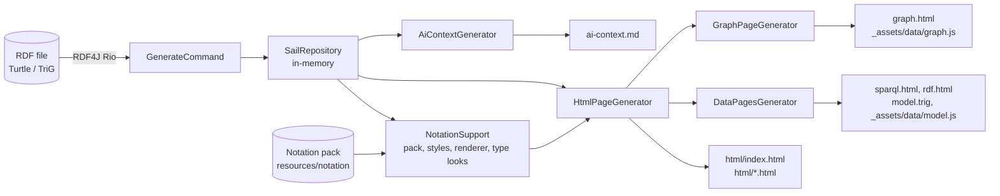
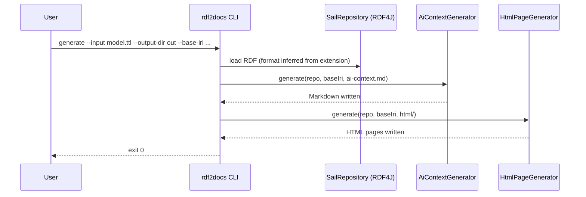

# Architecture and flow

## Components



## Conversion sequence



## What each generator queries

Both generators start from the same subject query, `HtmlPageGenerator.querySubjects`: every IRI subject
under `--base`, with its types, its label and the few statements that decide what it is (an `arch:source`,
an `arch:inModel`, a folder listing it, a `schema:subjectOf` pointing at it, a `dcterms:isReplacedBy`).
Each subject is then a view, relationship, element, model, documentation section, provenance record or
former name, or gets no page at all; the rules are in
[Which resources get a page](02-output-format.md#which-resources-get-a-page).

### AiContextGenerator

Writes the views, elements, relationships, models and documentation sections, one document per model:

1. **Models**: each `arch:Model` and the namespace it states (`vann:preferredNamespaceUri`), and each
   resource's `arch:inModel`. A resource is in its model's document; one with no `arch:inModel` is in the
   document of the model whose namespace its IRI is in.
2. **Per resource**: its literal properties and `schema:additionalProperty` pairs as metadata, and its
   IRI-valued statements as relationships.
3. **Elements in view**: for each view, `archvis:view` → `archvis:archElement`.
4. **Documentation**: for each section, what it documents (`schema:subjectOf`) and its `schema:text`.

### HtmlPageGenerator

Writes a directory per page, then the index:

- **Owners of parts**: every subject that gets no page is matched to the closest page its IRI extends,
  `{owner}/{part}` or `{view}#{shape}` (DD-41's owner rule). That page shows it, and its `facts.ttl`
  holds its statements.
- **Per-resource directory** (`<path>/`):
  - `index.html` — the Details table, with parts drawn inline, and the sections that apply (see
    [Resource page sections](02-output-format.md#resource-page-sections))
  - `facts.ttl` — the resource's statements, its parts' and, for a view, its shapes', as Turtle 1.2
  - `diagram.svg` — for a view with geometry; the same drawing is inline in `index.html`
- **Provenance**: for each page, the PROV statements on the resource, else on the named graph that types
  it, else on its model.
- **Index**: the `arch:Folder` tree, then models, documentation, the remaining views, elements and
  relationships, and provenance records; and the same concepts by type, in their languages' groups.
  `graph.html` shows views, elements and relationships.
- **Layout** (`PageLayout`): every page's header — Index, Graph, SPARQL, RDF, and the *Models* and *Folders*
  menus — and, on the index and the resources' pages, the model tree's panel on the left.

### TreeDataGenerator

Writes `_assets/data/tree.js`, what the model tree is built from, as la-gram's Model Explorer builds it from a
model's contents: for each model, its views (with their kind), its elements, its relationships (named by their ends
when they have no name), the concepts of types no loaded language defines (*Unclassified*), and its folders with
their parents and what each holds; and each type's name and icon. A concept is in the model it states with
`arch:inModel`, else in the model whose namespace its IRI is in. `_assets/js/tree.js` lays the tree out as
la-gram's `model-explorer.ts` and the kernel's `folders.ts` do — Views, Elements and Relationships by type, or each
group with the model's own folders first, a converter's folder for the model itself shown as the model — and fills
the header's menus.

### GraphPageGenerator

Writes `graph.html` and its data, `_assets/data/graph.js`: the elements and views as nodes, each with its type's
look (its icon, its glyph and picture, its shape and colours, its group); the relationships, and the views' membership, as edges, each
relationship with its notation's line style and end decorations; the types, the models and the folder tree for
the filters. The page's script, `_assets/js/graph.js`, draws it with D3 or with Cytoscape.js.

### DataPagesGenerator

Writes `model.trig`, the whole graph, and `_assets/data/model.js`: the prefixes, and each named graph's statements
by subject, a Turtle block each; where each page is, its name and its icon; and example queries. `sparql.html`
loads the blocks into Oxigraph as TriG; `rdf.html` shows and filters them.

## The notation

The diagrams, the type icons, the graph's figures and the lists' groups come from the visual notation of the
model's languages — the `arch-vis:` vocabulary of the Linked.Archi metamodels, read as the
[Visual Notation Guide](https://meta.linked.archi/docs/guide/visual-notation-guide/) has it. The code in
`src/main/kotlin/archi/linked/rdf2docs/notation/` is a port of the notation layer la-gram draws with, so that a view
documented here looks as it does there:

| Kotlin | Ported from | What it does |
|---|---|---|
| `Notation.kt` | kernel `metamodel-manager/notation.ts` | Reads notation sets, element and relationship styles, a notation's own shapes, label expressions, decoration symbols |
| `NotationPack.kt` (`NotationStyles`) | kernel `metamodel-manager/notation-resolver.ts`, la-gram `ui/canvas/notation-styles.ts` | The lookup: the active set, the fallback layers, the class's own picture, the nearest superclass, the defaults |
| `Appearance.kt` | kernel `model-manager/appearance.ts` | A node's or a line's own look (`arch-vis:style`), its colours read as meant |
| `ModelLabels.kt` | kernel `context-names.ts`, `element-pictures.ts`, `label-expression.ts` | A concept's name and picture for a presentation context, and label expressions |
| `Shapes.kt` | la-gram `ui/canvas/notation-shapes.ts` | The core shapes, a notation's own shapes from their path templates, badge placement, label wrapping and layout, end markers, type icons |
| `DiagramRenderer.kt` | la-gram `ui/canvas/rdf-renderer.ts` | A view as SVG: the three rendering modes, the figures (group, note, shape, reference), nesting, lines docked on the outlines drawn |

The **notation pack** is the languages' Turtle files, in `src/main/resources/notation/`, laid out as
`https://meta.linked.archi/` is published: for each language its manifest, ontology, notation, presentation
contexts and taxonomy. A run loads the core and the languages the model's IRIs are in, the model's own
metamodels first. `scripts/sync-notation.sh` refreshes the pack from linked-archi-meta.

**The notation's pictures are meta.linked.archi's.** A glyph (`arch-vis:iconSymbol`), a type's picture
(`arch:prefVisNotation`) and a decoration's symbol (`arch-vis:decorSymbol`) are IRIs under
`https://meta.linked.archi/`, which serves them; the pages show them there, and nothing is copied into the jar or
the site. A decoration's symbol is drawn inside a line's marker, in the line's colour, so its content is read
(`Published.kt`) when a view is drawn — once a run, and, when meta.linked.archi cannot be reached, not at all: the
marker then has the same decoration's built-in geometry.

**Presentation contexts.** A context may name another notation set (`arch:usesNotationSet`), and the model may
give an audience its own names (SKOS-XL labels), pictures (`arch:altVisNotation`), label expressions and looks
(a style with `arch:inPresentationContext`). A view's page draws the view for the default context —
`--presentation-context`, else the language's notation — with its shapes' fragments as ids, and for each other
context that draws it differently a second drawing, shown when the context is chosen.

**Type looks.** `TypeLooks` gives each type its icon: what meta.linked.archi publishes for it, as published. That is
the type's picture (`arch:prefVisNotation`), its whole figure, drawn 32 × 16; else its glyph (`arch-vis:iconSymbol`)
alone, 16 × 16; else no icon, an empty place so that names line up. A relationship type without a picture is its
whole line, drawn from its notation (`Shapes.relationshipIconDataUri`, a port of la-gram's `relationshipIconDataUri`):
a 24 × 24 SVG, a short diagonal from the source at the lower left, in its line style and colour, with both ends'
decorations at three quarters of their size — a `data:` URI, so that its markers' ids are its own. A type with no
notation is a plain line. A view has the tree's mark for one: ▦, ☰ for a catalogue, ▤ for a matrix.
An IRI meta.linked.archi answers 404 or 410 for is passed over for the next choice, in the icons and in the
diagrams' badges alike: `Published.serves` asks once a run (a `HEAD` request), and when meta.linked.archi cannot be
reached the IRIs are linked unchecked. It also gives the graph each type's glyph, picture, shape and colours, and each
type its group: the taxonomy concept that has it as `skos:narrower`, a layer or domain first, ordered as the
taxonomy's ordered collection lists them.

## Shapes and parts

A converter writes a view's shapes (`archvis:ArchNode`, `archvis:Link`), their styles and points, and the
parts of a resource (property pairs, folder entries, tags, route cells), each with an IRI under its owner.
None of them is an architecture concept, and none gets a page. A shape is a fragment of its view's page,
where the diagram gives it its fragment as `id`, and a part is shown on its owner's page.

---

## HTML directory structure and converter alignment

`rdf2docs` is model-agnostic: it strips the `--base` prefix from every IRI in the graph to derive the
output path. The directory structure therefore reflects the IRI layout the converters mint, which DD-41
fixes for every Linked.Archi tool: a model's namespace is `{base}{notation}/{modelId}/`, and in it are
`model` for the model, `{kind}/{id}` for each resource in its own right, `{view}#node-{id}` and
`{view}#link-{id}` for the shapes of a view, and `{owner}/{part}` for a part (`{shape}-{part}` for a shape's).

### How paths are derived

```
IRI:  https://example.org/la/model/payment-platform/element/id-ba-merchant
base: https://example.org/la/
→     html/model/payment-platform/element/id-ba-merchant/index.html

IRI:  https://example.org/la/bpmn/order-domain/element/Task_CheckInventory
base: https://example.org/la/
→     html/bpmn/order-domain/element/Task_CheckInventory/index.html
```

Converters given the same `--base` write their models side by side, one directory per notation and model:

```
html/
  model/payment-platform/            ← ArchiMate ({notation} is "model"; the platform passes "archimate")
    model/
    folder/…                         ← folders have no page; the index shows them
    element/id-ba-merchant/
    relationship/id-rel-1/
    view/id-v1/
  bpmn/order-domain/                 ← BPMN
    element/Task_CheckInventory/
    relationship/Flow_1/
    view/order-fulfillment/
  backstage/payment-catalog/
    element/component/default/payment-api/   ← a Backstage id is three segments, so three directories
  provenance/
    run/…  agent/…  source/…
```

### Folders

The ArchiMate Exchange format carries an explicit `<organizations>` folder hierarchy, and the converter
emits `arch:Folder` nodes that mirror the modeller's own organization. The other converters give each model
a root folder, `{ns}folder/am-root`, with *Elements*, *Relationships* and *Views* folders under it, placed in
the root by `dcterms:isPartOf`. The model tree shows either, in its *Folders* grouping.

### Views

| Aspect | ArchiMate | BPMN |
|---|---|---|
| Model granularity | One model = one Exchange XML file | One model = one `.bpmn` file, or several named by a diagrams index |
| View IRI | `{ns}view/{id}` | `{ns}view/{id}` with the id a diagrams index gives; else, for a collaboration, its first process (`{ns}element/{processId}`); else `{ns}view/{diagramId}` |
| Shapes | `{view}#node-{id}`, `{view}#link-{id}` | The same, with the BPMNDI shape and edge ids |
| Pages | One per view | One per view; a process that is its view has one page, which shows the diagram |
